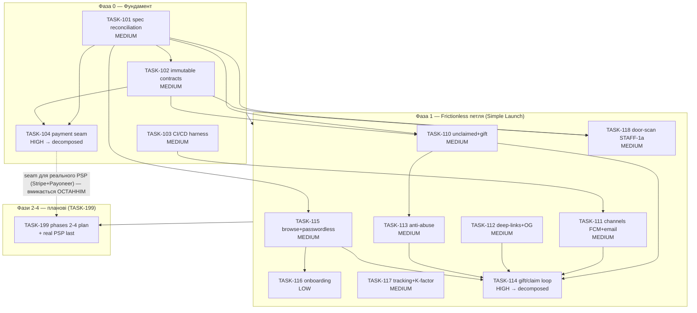

# TASK-100 — Underground v2 Build (батьківська задача)

| Поле | Значення |
|---|---|
| **ID** | TASK-100 |
| **Тип** | Parent / Epic (v2 release train) |
| **Status** | **DECOMPOSED** |
| **Owner** | Head of Engineering |
| **Estimation** | **HIGH → декомпозовано** (див. §12.5/§12.6) |
| **Governing** | `docs/rules.md` v0.5.0 (STRICT) · `docs/spec.md` (business truth) |
| **Джерела** | `docs/analysis/2026-06-29-audit-consolidated-roadmap.md`, `docs/analysis/2026-06-29-payments-worldwide.md` |
| **Дата** | 2026-07-01 |

---

## 1. Raw Request

> «Ти Head of Engineering Underground. Збери v2 продукту за строгим процесом `docs/rules.md`. Стратегія — **product-first, payment last**: перший цінний реліз (Simple Launch) на free/RSVP з `NoopProvider`; реальні гроші/ledger/compliance — після PMF. Замкнути end-to-end frictionless віральну петлю (лінк без акаунта → подарунок → реєстрація тут же → re-share) з робочими каналами доставки, anti-abuse-контуром і вимірюваністю. Дешеві незворотні контракти (minor-units, `event_timezone`, i18n-каркас) — зафіксувати ЗАРАЗ. Усі Фази 2-4 — спланувати як майбутні батьківські задачі; реальний PSP (Stripe Connect + Payoneer) вмикається ОСТАННІМ за seam `escrow.rs`.»

Похідне з консолідованого аудиту (PM/Marketing/Design/Cross-cutting) та платіжного дослідження. Аудит виявив системні розриви: обірвана центральна віральна петля, TODO-заглушки каналів (FCM `main.rs:139`, email `main.rs:172`), падіння `transfer_ticket` (`api/src/tickets.rs:265`) на незареєстрований email, нульовий вимірювальний шар і **два взаємовиключні роадмапи в repo** (порушення §0).

---

## 2. Refined Description

### 2.1. Scope

TASK-100 — це **release-train координатор** усього v2. Він НЕ несе власного коду. Його робота — розкласти чотири фази роадмапу на керовані задачі повного lifecycle (§12) зі спеками (§3), зафіксувати порядок виконання, залежності та gating. Прямий код виконується **лише в LOW-листках** дочірніх задач.

**Входить у координацію TASK-100:**

- **Фаза 0** (Фундамент) — TASK-101, TASK-102, TASK-103, TASK-104. Спец-рішення (product-first, auth-виняток, minor-units, timezone) → у `spec.md` ПЕРЕД будь-яким фіче-кодом.
- **Фаза 1** (Frictionless віральний контур = Simple Launch) — TASK-110..118. Перший цінний реліз на free/RSVP + `NoopProvider`.
- **Фази 2-4** — координуються через дочірню планову задачу **TASK-199** (батьківські задачі майбутніх ініціатив, декомпозуються при плануванні відповідної фази).

### 2.2. Non-goals (v2 свідомо НЕ робить зараз)

- Реальні гроші, ledger double-entry, reconciliation, generic webhook receiver, KYC/KYB queue, anti-fraud risk-console — **Фаза 4** (real-money back-office).
- Реальний PSP (Stripe Connect + Payoneer) — вмикається **Фаза 3-4** за seam TASK-104, НЕ раніше.
- «Другий Instagram» (composer/threads/likes/DM real-time), map-view на першому екрані, per-tier UI, TOTP rotating-QR, offline Room-scan-черга, resale-реалізація, FX/RTL — заморожено до density в Києві (роадмап §6).

### 2.3. Impacted UC / BR / WF

- Нова поведінка (стан `unclaimed`, passwordless email-код, browse-before-auth, gift-link, delegated door-scan) вводить **нові UC** — фіксуються як «new UC required» у **TASK-101 (spec reconciliation)** ПЕРЕД кодом (§2.2).
- BR/WF грошей (`HELD→CLEARING→CLEARED→PAID_OUT`, `DISPUTED`/`REFUNDED`) лишаються незмінними; TASK-104 лише вводить `trait PaymentProvider` + `Noop/Test` за наявним seam `escrow.rs`/`payouts.rs`/`orders.rs`/`webhooks.rs` — **provider-neutral**, без breaking (§8, §10).

### 2.4. Dependencies

- Зовнішні: жодних до Фази 3-4 (реальний PSP і юр-особа Atlas — паралельний трек засновника, не блокує product-first фази).
- Внутрішні: суворий порядок фаз (Фаза 0 → 1 → 2 → 3 → 4); граф у §7.

### 2.5. Risks

| Ризик | Мітигація |
|---|---|
| Часткова реалізація віральної петлі = 0 K-factor | TASK-114 не вмикається без TASK-110/111/112/113 (роадмап §7) |
| Frictionless-шлях = фрод-вектор | TASK-113 (anti-abuse) — **умова готовності** TASK-114, не паралель |
| Незворотні контракти на живому продукті → breaking-міграції | TASK-102 фіксує minor-units/timezone/i18n у Фазі 0, до фіче-коду |
| Два роадмапи (порушення §0) | TASK-101 закриває конфлікт у `spec.md` першою задачею |
| Провайдер-lock-in у `webhooks.rs` | TASK-104 вводить seam за provider-флагом паралельно наявному шляху |
| Неінструментовані фічі | TASK-117 (tracking plan) — gate готовності релізу Фази 1 |

---

## 3. Чому це HIGH і чому декомпозовано (§12.5 / §12.6)

TASK-100 охоплює **4 фази, 27+ ініціатив/задач, 4 шари** (API Rust/Axum · Android Compose · Admin Next.js · Infra/CI), кілька нових UC та незворотні контракти даних. За §12.5 це однозначно **HIGH / IMPOSSIBLE TO ESTIMATE** як єдина одиниця → **імплементація ЗАБОРОНЕНА** до повної декомпозиції в LOW-листя.

Декомпозиція проведена по натуральних межах §12.6:

- **Sequential phases** — Фаза 0 (контракти) → Фаза 1 (петля) → Фаза 2 (discovery/trust/supply) → Фаза 3 (гроші/lifecycle) → Фаза 4 (back-office). Схема даних перед API перед UI всередині кожної задачі.
- **Distinct UC** — gift-claim, browse-before-auth, door-scan, discovery, checkout — кожен окремою задачею.
- **Distinct layer** — де задача перетинає API+Android+Web (напр. TASK-112 deep-links, TASK-114 gift-loop), декомпозиція каскадує в per-layer листя (`TASK-###-A-...`) на етапі REFINED кожної задачі.
- **Distinct BR/WF** — грошова FSM (TASK-104) відокремлена від фіче-петлі.

Фази 0-1 вже розгорнуті в окремі TASK/SDD файли (нижче). Фази 2-4 наразі — **батьківські планові задачі у TASK-199**; кожна буде декомпонована у LOW-листя при вході у відповідну фазу (§12.6: «Parent → DECOMPOSED; only leaf sub-tasks are implemented directly»).

---

## 4. Таблиця: Фази → ініціативи → TASK-id → estimation → залежності

### Фаза 0 — Фундамент та єдине джерело істини (тижні 1-2)

| Ініціатива | TASK | Estimation | Gate (§12.5) | Залежності |
|---|---|---|---|---|
| INIT-ROADMAP-SPEC | **TASK-101** — Реконсиляція `spec.md`: product-first + auth-доктрина + minor-units/timezone | MEDIUM | flag+confirm | — |
| INIT-CONTRACTS | **TASK-102** — Незворотні контракти: minor-units гроші, `event_timezone`, i18n-каркас | MEDIUM | flag+confirm | TASK-101 |
| INIT-ROADMAP-SPEC (infra) | **TASK-103** — CI/CD pipeline + container-first тест-харнес | MEDIUM | flag+confirm | — |
| INIT-ROADMAP-SPEC (payments-seam) | **TASK-104** — Payment-provider seam: `trait` + Noop/Test провайдери + ledger | **HIGH → decompose** | MUST decompose | TASK-101, TASK-102 |

### Фаза 1 — Frictionless віральний контур = Simple Launch (перший цінний реліз)

| Ініціатива | TASK | Estimation | Gate (§12.5) | Залежності |
|---|---|---|---|---|
| INIT-TICKET-UNCLAIMED | **TASK-110** — Стан квитка `unclaimed` + подарунок на незареєстрований email | MEDIUM | flag+confirm | TASK-101, TASK-102 |
| INIT-CHANNELS | **TASK-111** — Канали доставки: FCM push + транзакційний email | MEDIUM | flag+confirm | TASK-103 |
| INIT-DEEPLINKS | **TASK-112** — Universal links + OG-превʼю для всіх share-обʼєктів | MEDIUM | flag+confirm | — |
| INIT-ANTIABUSE | **TASK-113** — Anti-abuse контур навколо guest/gift-claim | MEDIUM | flag+confirm | TASK-110 |
| INIT-GIFTLINK | **TASK-114** — Наскрізний frictionless gift/claim віральний контур | **HIGH → decompose** | MUST decompose | TASK-110, TASK-111, TASK-112, TASK-113, TASK-115 |
| INIT-BROWSE-AUTH | **TASK-115** — Browse-before-auth + passwordless email-код | MEDIUM | flag+confirm | TASK-101 |
| INIT-ONBOARDING | **TASK-116** — Не-блокуючий онбординг + contextual permission priming | **LOW** | proceed → Speck+код | TASK-115 |
| INIT-ANALYTICS | **TASK-117** — Tracking plan + воронка покупки + K-factor атрибуція | MEDIUM | flag+confirm | — |
| INIT-DOORSTAFF (STAFF-1a) | **TASK-118** — Делегований door-scan + безпечний QR + вердикти | MEDIUM | flag+confirm | TASK-101, TASK-102 |

### Фази 2-4 — планові батьківські задачі (координуються через TASK-199)

| Фаза | Ініціатива | Майбутня TASK (planned) | Прогноз-оцінка | Enable-момент |
|---|---|---|---|---|
| 2 | INIT-DISCOVERY | TASK-199 → child | MEDIUM | По завершенні Фази 1 |
| 2 | INIT-TRUST-ESCROW | TASK-199 → child | MEDIUM | Після TASK-111 |
| 2 | INIT-QUICKCREATE | TASK-199 → child | MEDIUM | Після TASK-102 |
| 2 | INIT-LIFECYCLE-TRIGGERS | TASK-199 → child | MEDIUM | Після TASK-111, TASK-117 |
| 2 | INIT-COLDSTART | TASK-199 → child | MEDIUM | Операційно паралельно |
| 2 | INIT-SEO | TASK-199 → child | MEDIUM | Паралельний трек |
| 3 | INIT-CHECKOUT | TASK-199 → child | **HIGH** | Після реального PSP (TASK-104 seam) |
| 3 | INIT-TICKET-LIFECYCLE | TASK-199 → child | **HIGH** | Після TASK-110, TASK-102 |
| 3 | INIT-ORGANIZER-CHANNEL | TASK-199 → child | **HIGH** | Після TASK-117 |
| 3 | INIT-RSVP-SOCIAL | TASK-199 → child | MEDIUM | Після TASK-111 |
| 3 | INIT-LOCALE-ASO | TASK-199 → child | MEDIUM | Після TASK-102, TASK-101 |
| 3 | INIT-EXPERIMENTS | TASK-199 → child | MEDIUM | Після TASK-117 |
| 3 | INIT-DESIGN-TOKENS | TASK-199 → child | MEDIUM | Розблоковує M9 |
| 3-4 | **Реальний PSP (Stripe Connect + Payoneer)** | TASK-199 → child (за seam TASK-104) | **HIGH** | ОСТАННІМ, після PMF |
| 4 | INIT-COMPLIANCE-GUARDS | TASK-199 → child | MEDIUM | З реальними грошима |
| 4 | INIT-RESALE | TASK-199 → child | **HIGH** | Після TASK-TICKET-LIFECYCLE + ліквідності |

> Кожна MEDIUM/HIGH дитина TASK-199 проходить `flag+confirm` (MEDIUM) або `MUST decompose` (HIGH) на вході у свою фазу — див. §6 Gating.

---

## 5. Execution Order

**Строгий фазовий порядок — Фаза N+1 не стартує, доки Фаза N не `DONE` за §11.**

1. **Фаза 0 (спершу spec, потім контракти, потім seam):**
   `TASK-101 → TASK-102 → {TASK-103 ∥ TASK-104}`.
   TASK-101 — абсолютний перший (закриває конфлікт роадмапів §0 у spec). TASK-104 (HIGH) декомпонується у LOW-листя (schema-ledger → `trait` → Noop → Test → webhook-seam) до коду.
2. **Фаза 1 (петля будується цілісно):**
   Прекурсори паралельно: `TASK-110 ∥ TASK-111 ∥ TASK-112 ∥ TASK-115 ∥ TASK-117`.
   Потім `TASK-113` (потребує TASK-110). Потім `TASK-116` (потребує TASK-115).
   **`TASK-114` — ОСТАННІМ** у фазі: збирає петлю end-to-end на всіх прекурсорах (роадмап §7 — часткова реалізація заборонена). `TASK-118` — паралельно (незалежний door-scan).
   **Gate релізу Simple Launch:** share→claim ≥ 30%, guest→signup ≥ 40%, K-factor ≥ 0.5 (роадмап §9.2), інструментовано TASK-117.
3. **Фаза 2 → 3 → 4** — через TASK-199, кожна фаза декомпонується при вході.

**Незмінний інваріант:** реальний PSP — ОСТАННІМ (product-first). До PMF усі грошові шляхи через `NoopProvider`/`TestProvider` за seam TASK-104.

---

## 6. Gating (§12.5)

- **VERY LOW / LOW** — TASK-116 та всі листя після декомпозиції: **проходять напряму** до Speck + імплементації.
- **MEDIUM** — TASK-101, 102, 103, 110, 111, 112, 113, 115, 117, 118 та MEDIUM-діти TASK-199: **flag + confirm у користувача ПЕРЕД стартом**.
- **HIGH / IMPOSSIBLE** — TASK-104, TASK-114 та HIGH-діти TASK-199 (INIT-CHECKOUT, INIT-TICKET-LIFECYCLE, INIT-ORGANIZER-CHANNEL, INIT-RESALE, реальний PSP): **імплементація ЗАБОРОНЕНА** до повної декомпозиції в LOW-листя (§12.6). Parent → `DECOMPOSED`; виконуються лише листя.

**Умови готовності поверх gating (роадмап §7):**

- TASK-114 (gift-loop) не вмикається без TASK-113 (anti-abuse) — frictionless ≠ діряво.
- Кожна віральна/конверсійна фіча не виходить без tracking-подій TASK-117 — «все вимірюване».
- Speck-audit (§3) + security-audit (§9.1: без нових high/critical) — щозадачі перед `DONE`.

---

## 7. Dependency graph (mermaid)

---

## 8. Definition of Done

TASK-100 вважається `DONE` **лише** коли всі дочірні задачі (Фази 0-1: TASK-101..118; Фази 2-4: усі листя TASK-199) — `DONE`/`REJECTED`/`DUPLICATE`, і кожна задовольняє **`docs/rules.md` §11**:

- **Docs:** `spec.md`, `development-manual.md`, `installation-manual.md`, `configuration-manual.md`, `docs/specks/`, `docs/backlog/` (усі задачі термінальні), `docs/ui-baselines/`, `docs/ui-schematics/`, `docs/ui-design-tokens.md`.
- **Infra:** root `docker-compose.yml`; `.env` з безпечними дефолтами (без реальних секретів), усі порти конфігуровні; `.dockerignore`; reverse-proxy (§8.5); production images (§8.3).
- **Tests:** fail-fast стадії; 100% unit+integration coverage; 100% curl route coverage (positive/negative/security); UI покриває всі UC + edge + negative + `[SEC]` + device matrix + demo; Playwright-відео на кожен UC; `[SEC]`-мітки на кожній застосовній стадії.
- **Release-gate Фази 1 (Simple Launch):** share→claim ≥ 30%, guest→signup ≥ 40%, K-factor ≥ 0.5 (роадмап §9.2).

Повний список — `docs/rules.md` §11.
