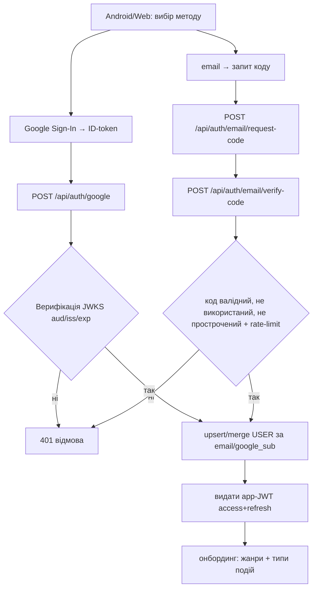
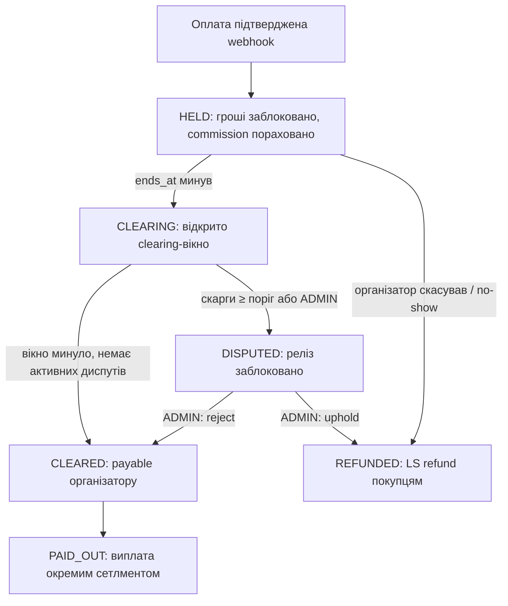
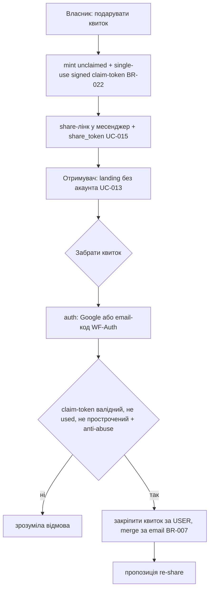
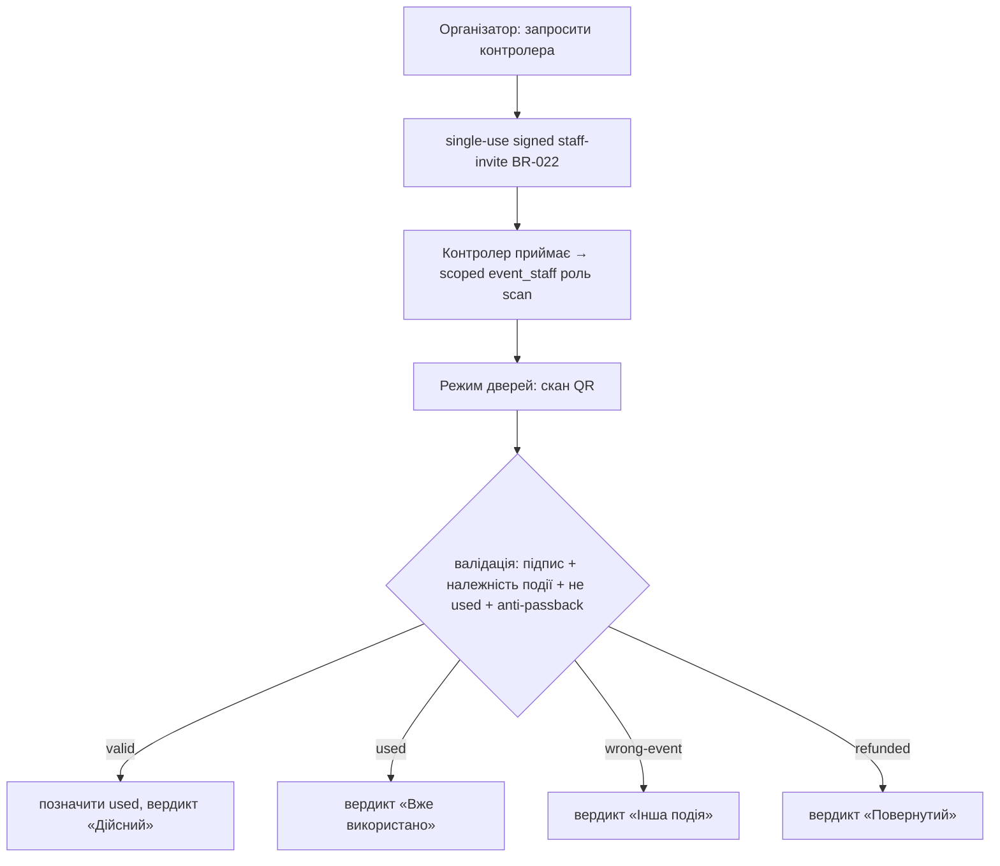

# Underground — Specification (business truth)

> Per `docs/rules.md` §2.2 this is the business truth. Agents MUST NOT implement behavior contradicting it.
> Per-UC backend/frontend technical contracts (endpoints, screens, Mermaid, schematics, baselines per §2.3)
> are finalized in each UC's task Speck (`docs/specks/SDD-*`) **before** that UC is implemented — no silent drift.

## 1. What the system does

Underground — мобільна платформа, що поєднує **афішу подій**, **продаж квитків** і **соцмережу** навколо
концертів / вечірок / стендапу / бізнес-подій (UA-ринок). Користувач знаходить події, купує квитки (e-квиток із QR),
спілкується (стрічка, підписки, чати) і, як організатор, створює події та продає на них квитки.

## 2. Business value

- Для відвідувача — єдине місце знайти подію, безпечно купити квиток і не втратити гроші, якщо подію не проведуть.
- Для організатора — канал продажу з аудиторією та виплатою після проведення події.
- Для платформи — комісія з кожного проданого квитка (маркетплейс).

Ключова довіра-механіка: **гроші утримуються в ескроу** й виплачуються організатору лише після того, як подія
відбулась і минув clearing-період без підтверджених диспутів. Це унеможливлює «зібрав і зник».

### 2.1 Доктрина постачання — product-first, payment last (TASK-101)

Underground будується **product-first**: спершу цінний, вимірюваний продукт, реальні гроші — останніми.

- **Simple Launch (перший реліз)** працює на безкоштовних подіях / RSVP та на `NoopProvider`/`TestProvider` за
  seam `api/src/escrow.rs` — **без реального руху коштів**. Ескроу-стани (`HELD→CLEARING→CLEARED→PAID_OUT`,
  `DISPUTED`/`REFUNDED`) — це provider-neutral доменна машина; активний провайдер обирається через `payment_settings`.
- **Реальний PSP** (Stripe Connect для прийому+ескроу, Payoneer для виплат у країни поза Stripe; US-entity via
  Stripe Atlas) вмикається **ОСТАННІМ** (Фаза 3–4), за тим самим seam, без зміни доменної логіки (BR-021).
- **Gate готовності Simple Launch:** share→claim ≥ 30 %, guest→signup ≥ 40 %, K-factor ≥ 0.5 (виміряно UC-015).
- **Незворотні контракти фіксуються ЗАРАЗ** (до фіче-коду): гроші — у minor-units (BR-019); кожна подія має
  `event_timezone` і час показується в поясі події (BR-020); i18n-каркас (uk/en).

## 3. High-level architecture / flow

- **Android-клієнт** (Kotlin/Compose, dark-only) — увесь користувацький UX.
- **API** (Rust/Axum/SQLx/PostgreSQL) — домен, auth, платежі, ескроу, адмін-API.
- **Web-admin** (Next.js) — модерація, фінанси, ескроу-керування; б'є по `/api/admin/*`.
- **Зовнішні**: Google OAuth + passwordless email-код (вхід); платіжний провайдер — **змінний** за `trait PaymentProvider`
  (product-first: `Noop`/`Test` зараз; реальний PSP Stripe Connect + Payoneer — Фаза 3–4). Push — FCM; email — транзакційний outbox.
- Гроші змінюються виключно через єдиний seam `api/src/escrow.rs` (BR-006).

## 4. Actors

- **Гість** — неавтентифікований; перегляд афіші, деталей події та landing подарунка (browse-before-auth, UC-013).
- **USER** — увійшов через Google або passwordless email-код; купує квитки, дарує/забирає, підписується, постить, пише, скаржиться.
- **Door-staff (делегат)** — USER із scoped-роллю `event_staff` на конкретну подію; лише сканує квитки на вході (UC-014).
- **Організатор** — будь-який USER, що створив подію; продає квитки, сканує QR, отримує виплати.
- **ADMIN** — модерує користувачів/події/скарги, керує диспутами/ескроу/виплатами.

## 5. Use cases

> Кожен UC отримує повні §2.3-секції (FR / BE-tech / FE-tech / Flow / schematics / baselines) у своєму Speck
> перед реалізацією. Нижче — бізнес-рівень: Summary, Description, Functional Requirements, Related BR/WF.

### UC-001 — Вхід (Google або passwordless email-код) + онбординг
**Summary:** користувач входить через Google АБО одноразовий email-код і обирає вподобання. (Оновлено TASK-101.)
**Description:** гість обирає метод: (а) Google Sign-In → ID-token → бекенд верифікує (JWKS aud/iss/exp); або
(б) **passwordless email one-time code** — вводить email → отримує короткоживучий код → підтверджує. Обидва шляхи
видають app-сесію (JWT access+refresh) → онбординг (жанри + типи подій). Passwordless-код — основний метод у
claim/guest-контексті (UC-013) з identity-merge за email. **Доктрина:** Google + passwordless-код; попередній
email+**пароль** визнано **deprecated** (видалення — окрема задача, не ламає наявні акаунти до міграції).
**Functional Requirements:** успіх → автентифікована сесія + збережені вподобання; невалідний/прострочений
Google-token → відмова; невірний/прострочений/використаний email-код → відмова без розкриття деталей; код
одноразовий і короткоживучий (`AUTH_CODE_TTL`); той самий email через Google і код не дублює акаунт (merge за
email); коди й токени ніколи не логуються у відкритому вигляді; видача коду rate-limited (BR-017).
**Related:** BR-007, BR-016, BR-017, WF-Auth.

### UC-002 — Перегляд афіші (пошук/фільтри)
**Summary:** перегляд опублікованих подій сіткою/списком із пошуком і фільтрами.
**Description:** користувач бачить події, фільтрує за містом/категорією/датою, шукає за назвою.
**Functional Requirements:** показуються лише `published` події; порожній результат → порожній стан; фільтри комбінуються.
**Related:** —.

### UC-003 — Деталі події + «цікаво»
**Summary:** перегляд деталей події й позначення інтересу.
**Description:** користувач відкриває подію (постер, опис, місце, дата, ціна, лишилось квитків) і може позначити «цікаво».
**Functional Requirements:** неіснуюча подія → not-found; «цікаво» ідемпотентне; гість бачить деталі, але не може «цікаво».
**Related:** BR-008.

### UC-004 — Купівля квитка
**Summary:** купівля квитка через hosted checkout провайдера, отримання e-квитка з QR.
**Description:** checkout **резервує місце** за покупцем на `HOLD_MINUTES` (15 хв) у тій самій транзакції, що й
замовлення; покупець платить у провайдера; webhook `Paid` мінтить квиток і заводить ескроу `HELD`. Не оплачене за час
холду замовлення стає `expired`, місце повертається в продаж (фоновий sweep). Оплата, що прийшла ПІСЛЯ холду, видає
квиток, якщо місце ще є; якщо ні (або промокод вичерпано іншим платником) — замовлення стає `paid` + ескроу
`refund_due`, ставиться рядок у `refund_jobs`, покупцю повертаються гроші (PAY-3, PAY-11).
**Functional Requirements:** два одночасні checkout на останнє місце → рівно один 201; один покупець ніколи не тримає
двох місць на одну подію (повторний checkout закриває попередній холд); неавтентифікований → відмова; успіх → квиток з
унікальним QR; повторна доставка webhook не дублює квитки (ідемпотентність); **webhook ніколи не відповідає 4xx через
стан нашого домену** — провайдер не може виправити його повтором. `GET /api/orders/:id` (лише покупець) віддає
`hold_expires_at` і `checkout_url` для екрана оплати.
**Related:** BR-003, BR-004, BR-009, BR-013, BR-014, WF-Escrow.

### UC-005 — Передача / продаж / повернення квитка
**Summary:** власник квитка передає, виставляє на продаж або повертає квиток.
**Description:** дії над власним активним квитком; повернення ініціює refund-гілку ескроу.
**Functional Requirements:** лише власник; не можна діяти з використаним/повернутим квитком; повернення дозволене до завершення події.
**Related:** BR-005, BR-010, WF-Escrow.

### UC-006 — Організатор: керування подією
**Summary:** створення/редагування події, «хто купив», stop sales, видалення.
**Description:** USER створює подію (назва, опис, місто, адреса, дата/час, тип, ціна/безкоштовно, постер) і керує продажами.
**Functional Requirements:** лише організатор-власник редагує; stop sales припиняє продаж; видалення з проданими квитками → блок/попередження (узгодити в Speck).
**Related:** BR-011.

### UC-007 — Організатор: сканування QR на вході
**Summary:** валідація квитка сканером на вході.
**Description:** організатор сканує QR → бекенд валідує (належність події, не використаний) → позначає `validated_at` (сигнал відвідуваності).
**Functional Requirements:** чужий/підроблений/вже використаний QR → відмова з причиною; валідний → `used`; лише організатор події сканує.
**Related:** BR-012, WF-Escrow.

### UC-008 — Соц: профіль, підписки, пости, чати
**Summary:** профілі, підписка, пости/коментарі/лайки, особисті чати 1:1.
**Description:** користувач веде профіль, підписується на організаторів, постить у стрічку, коментує/лайкає, листується.
**Functional Requirements:** підписка/відписка ідемпотентні; пост/коментар лише автентифікованих; чат лише між учасниками діалогу.
**Related:** BR-013.

### UC-009 — Скарга та рейтинг
**Summary:** скарга на подію/організатора/користувача; рейтинг організатора.
**Description:** користувач лишає скаргу («Leave a complaint») або оцінює організатора; скарги впливають на ескроу.
**Functional Requirements:** скарга прив'язана до цілі й заявника; поріг скарг по події → диспут ескроу; один рейтинг на пару (user, organizer).
**Related:** BR-002, BR-014.

### UC-010 — Ескроу-розрахунок
**Summary:** утримання коштів і їхній реліз/refund навколо проведення події.
**Description:** системний UC — рушій станів ескроу між оплатою та виплатою/поверненням.
**Functional Requirements:** реліз лише з `CLEARED`; диспут блокує реліз; усі переходи журналюються; гроші лише через `escrow.rs`.
**Related:** BR-001, BR-002, BR-003, BR-005, BR-006, WF-Escrow.

### UC-011 — Адмін: модерація та фінанси
**Summary:** адмін модерує контент і керує диспутами/ескроу/виплатами.
**Description:** ADMIN у web-admin бачить дашборд, блокує користувачів, ховає/видаляє події, вирішує диспути, релізить/повертає ескроу, позначає виплати.
**Functional Requirements:** доступ лише ADMIN; кожна адмін-дія в `admin_audit`; рішення диспуту переводить ескроу у `REFUNDED`/`CLEARED`.
**Related:** BR-001, BR-002, BR-015, WF-Escrow.

### UC-012 — Подарунок / claim квитка (frictionless, без акаунта) (нове, TASK-101)
**Summary:** власник дарує квиток за посиланням; отримувач забирає його БЕЗ попереднього акаунта й реєструється в пару кліків.
**Description:** власник створює `unclaimed`-квиток (або дарує свій) → генерується single-use short-TTL signed claim-лінк →
надсилається в месенджер → отримувач відкриває landing (бачить подію+квиток без логіну), тисне «Забрати» → auth
(Google або email-код) → квиток закріплюється за ним. Джерело атрибутується `share_token` (UC-015).
**Functional Requirements:** claim-токен одноразовий, короткоживучий, підписаний (BR-022); квиток `unclaimed` до claim
(BR-018); подарунок не нараховує комісію (BR-003); повторний/протермінований токен → зрозуміла відмова; anti-abuse
(rate-limit, device/email-cap — UC-013/anti-abuse); identity-merge за email не дублює акаунт (BR-007).
**Related:** BR-003, BR-007, BR-018, BR-022, WF-GiftClaim.

### UC-013 — Browse-before-auth + passwordless вхід (нове, TASK-101)
**Summary:** анонім переглядає афішу/подію/подарунок до логіну; auth-wall підіймається лише в момент дії.
**Description:** гість бачить discovery, деталі події, landing подарунка без акаунта; логін (Google або passwordless
email-код) вимагається лише на дію (claim/buy/RSVP), після чого анонімний намір мерджиться в акаунт.
**Functional Requirements:** публічні read-endpoints доступні гостю; дія без сесії → м'який auth-prompt, не помилка;
passwordless-код одноразовий/короткоживучий/rate-limited (BR-016, BR-017); анонімний intent зберігається до auth і
застосовується після (без втрати наміру).
**Related:** BR-016, BR-017, WF-Auth, WF-GiftClaim.

### UC-014 — Делегований контроль на вході (door-staff) (нове, TASK-101)
**Summary:** організатор делегує персоналу право сканувати квитки без передачі свого акаунта.
**Description:** організатор запрошує контролера (single-use signed staff-invite) → у контролера з'являється scoped-роль
`event_staff` лише на цю подію → він сканує QR у «режимі дверей»; вердикти: valid / already-used / wrong-event /
refunded / not-yet-started. Сканування event-scoped, з online anti-passback.
**Functional Requirements:** сканувати може власник АБО делегований staff з правом `scan` на цю подію (BR-012);
staff НЕ має доступу до грошей/редагування/інших подій; підпис QR перевіряється; повторний вхід за токеном → відмова
(anti-passback); інвайт одноразовий/короткоживучий (BR-022).
**Related:** BR-012, BR-022, WF-DoorScan.

### UC-015 — Аналітика / вимірюваність (tracking + воронка + K-factor) (нове, TASK-101)
**Summary:** платформа інструментує ключові дії, будує воронку продажу й міряє віральність.
**Description:** системний UC — event-tracking seam (telemetry) емітить події (view, detail_open, tier_select,
checkout_start, paid, ticket_claimed, share_clicked, invite_sent/opened, guest_signup, rsvp_set, scan) з property-схемою;
серверна воронка view→paid→attend; K-factor через `share_token`-атрибуцію; north-star дашборд в admin.
**Functional Requirements:** кожна віральна/конверсійна дія має tracking-подію; агрегати нормалізовані в базову валюту
(minor-units, BR-019); дашборд лише ADMIN; жодних PII у property-схемі понад необхідне; трекінг не блокує основний потік.
**Related:** BR-015, BR-019.

## 6. Business rules (BR-###)

- **BR-001** Виплата організатору можлива лише з ескроу-стану `CLEARED` (подія завершена + clearing-вікно без активних диспутів).
- **BR-002** Скарги по події ≥ поріг `DISPUTE_THRESHOLD_BPS` від власників квитків → ескроу → `DISPUTED`, реліз заблоковано до рішення ADMIN.
- **BR-003** Платформа утримує комісію `PLATFORM_COMMISSION_BPS` від gross; `payable = gross − commission`.
  Комісія **не** нараховується з безкоштовних квитків/RSVP та з подарованих квитків (gift ≠ новий продаж) (уточнено TASK-101).
- **BR-004** Карткові дані не зберігаються (LS hosted checkout, платформа = MoR).
- **BR-005** Скасування організатором / no-show / підтверджений диспут → refund покупцям (LS Refund API), ескроу → `REFUNDED`.
- **BR-006** Будь-яка зміна грошей/ескроу — виключно через єдиний seam `api/src/escrow.rs`; провайдер платежів —
  змінний за `trait PaymentProvider` (Noop/Test/…), доменна ескроу-машина від провайдера не залежить (уточнено TASK-101).
- **BR-007** Один Google-акаунт (`google_sub`) = один USER; повторний вхід не дублює акаунт.
- **BR-008** Дія «цікаво» ідемпотентна на пару (user, event).
- **BR-009** Кількість проданих квитків не перевищує `tickets_total`; `tickets_left` ніколи < 0.
- **BR-010** Дії над квитком (передача/продаж/повернення/валідація) лише для власника/організатора у валідному статусі.
- **BR-011** Редагувати/зупиняти/видаляти подію може лише організатор-власник або ADMIN.
- **BR-012** QR-валідація приймає лише квиток цієї події, ще не `used`; повторне сканування → відмова.
- **BR-013** Місце береться атомарно на checkout і тримається `HOLD_MINUTES`; `tickets_left` ніколи не перевищує
  `tickets_total` (CHECK) — повернення, протермінування холду й провал платежу повертають місце через єдиний
  `tickets::release_seats` із стелею (PAY-3).
- **BR-014** Після того, як гроші списані, домен не має права відмовити: `fulfill` завершується `Fulfilled`,
  `AlreadyHandled` або `RefundDue` — ніколи помилкою за бізнес-причиною. `refund_due` = гроші є, квитка не буде,
  повернення в черзі `refund_jobs` (рівно один рядок на замовлення) (PAY-3).
  Сканувати може організатор-власник **або делегований `event_staff`** зі scoped-правом на цю подію; підпис QR
  перевіряється, online anti-passback блокує повторний вхід за тим самим токеном (уточнено TASK-101, UC-014).
- **BR-013** Чат доступний лише учасникам діалогу; дії в стрічці — лише автентифікованим.
- **BR-014** Один рейтинг організатора на пару (rater, organizer); скарга прив'язана до цілі й заявника.
- **BR-015** Кожна ADMIN-дія журналюється в `admin_audit`.
- **BR-016** Паролі зберігаються лише як argon2id-хеш; ніколи не логуються/не повертаються; перевірка — constant-time.
- **BR-017** Видача/перевірка auth (Google + email-код) rate-limited (`AUTH_LOGIN_RATE_LIMIT`) проти brute-force;
  акаунт за email унікальний; Google і passwordless-код мерджаться в один USER за email (оновлено TASK-101).
- **BR-018** Квиток може існувати у стані `unclaimed`/`pending_claim` (випущений/подарований на email без акаунта);
  закріплюється за першим, хто виконав claim валідним токеном; до claim він не активний і не сканується (UC-012).
- **BR-019** Гроші зберігаються й передаються як **precise Decimal** (`NUMERIC(12,2)` ↔ `rust_decimal::Decimal`),
  **ніколи не float**. (Реконсиляція TASK-102: кодова база вже задовольняє це; окрема міграція в `i64` minor-units
  визнана НЕпотрібною й ризикованою — Decimal коректний для грошей. Ескроу/ledger теж на Decimal.)
- **BR-020** Кожна подія має `event_timezone` (IANA); час події зберігається в UTC і **показується в поясі події**;
  заборонено substring-форматування дати/часу (guardrail проти зсувів поясів).
- **BR-021** Payout можливий лише коли активний PSP підтримує реальні виплати; у product-first-режимі активний
  провайдер = `Noop`/`Test`, реальні перекази вимкнено (payout лишається доменним переходом без руху коштів) (§2.1).
- **BR-022** Claim/gift/staff-invite використовують **single-use short-TTL signed token** (окремий секрет,
  `CLAIM_TOKEN_TTL`); повторне використання/протермінований токен → відмова; токен не логується.
- **BR-023** Door-QR (вхідний квиток) — **signed short-TTL rotating token** (HS256, claims `tid`+`eid`+`exp`+`kind`,
  TTL `QR_TOKEN_TTL_SECS`, дефолт 120с), що видається власнику на льоту (`GET /api/tickets/:id/qr`, лише активний
  квиток) і авто-оновлюється клієнтом; сирий незмінний `qr_token` лишається у БД як стабільний ключ, але **не
  показується в UI** (скріншот тексту непридатний). **Валідація/скан приймають ЛИШЕ підписаний QR** (перевірка
  підпису+`exp`+`kind` → `tid`); протермінований/невалідний токен → `not_found`. Сирий `qr_token` на дверях **більше
  НЕ приймається** (замінює перехідний backward-compat, TASK-118-B Part A). Уточнює BR-012 «підпис QR перевіряється».
  (Micro-cleanup: прибрати `qr_token` з UI-DTO-відповідей — окреме листя.)
- **BR-024** Афіша-відкриття має **секційний time-aware варіант** (`GET /api/discover/sections`, additive — плоский
  `/api/discover` незмінний): секції `soon` (наступні 48 год), `weekend` (найближчі Сб–Нд), `for_you` (наявний
  персональний ranking, лише за наявності сигналу prefs/saves/follows), `popular` (momentum, завжди — cold-start
  fallback). Порожні секції не повертаються; кожна показує лише `published`-події, не власні події viewer, з наявними
  discovery-полями. Межі часу — server-UTC (спрощення; BR-020 стосується показу часу, не фільтра). (TASK-200/199-A.)

## 7. Workflows (WF-###)

### WF-Auth — вхід (Google або passwordless email-код) (оновлено TASK-101)

### WF-Escrow — життєвий цикл коштів

Рушій переходів `HELD→CLEARING→CLEARED` — фоновий `escrow::tick` (ідемпотентний). Виплати/refunds — через ADMIN/LS.

### WF-GiftClaim — подарунок і забір без акаунта (нове, TASK-101)

### WF-DoorScan — делеговане сканування на вході (нове, TASK-101)

## 8. Glossary

- **Clearing-вікно** — період після завершення події (`ESCROW_CLEARING_DAYS`), протягом якого приймаються диспути перед релізом.
- **GMV** — оборот квитків; **commission revenue** — дохід платформи з комісії.
- **MoR** — Merchant of Record (Lemon Squeezy приймає платіж від імені платформи).
