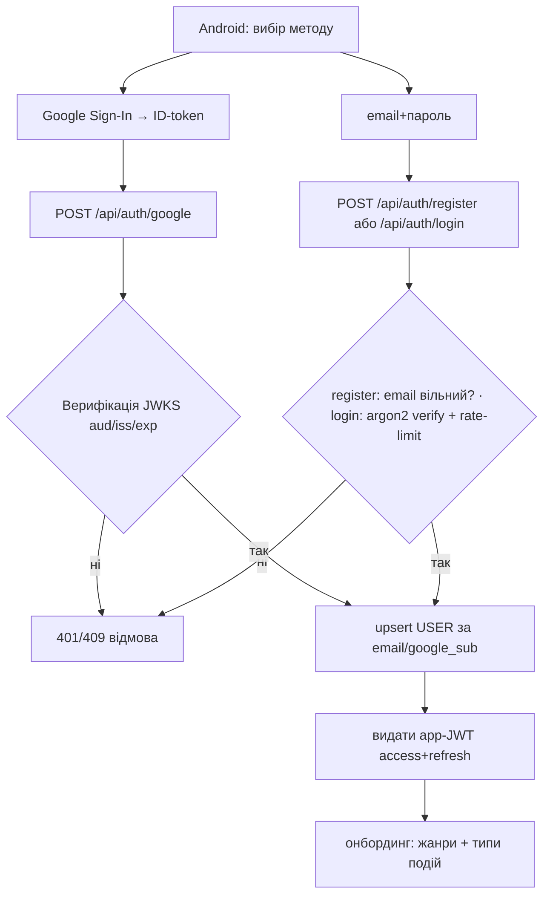
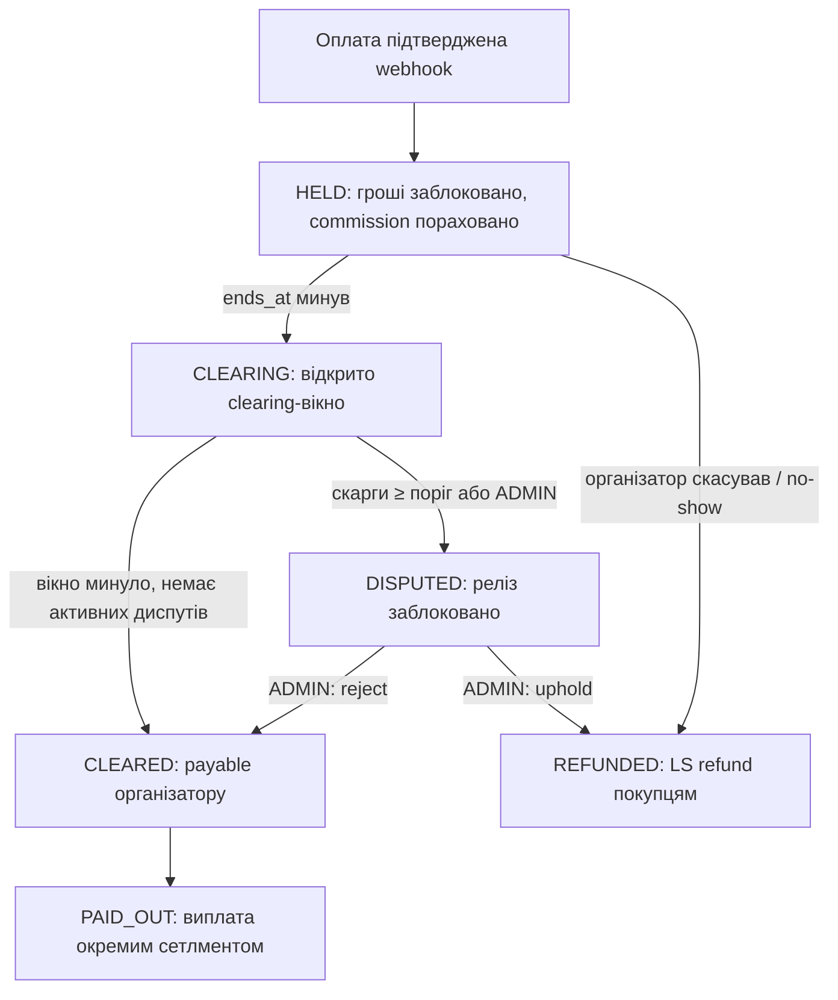

# Underground — Specification (business truth)

> Per `docs/rules.md` §2.2 this is the business truth. Agents MUST NOT implement behavior contradicting it.
> Per-UC backend/frontend technical contracts (endpoints, screens, Mermaid, schematics, baselines per §2.3)
> are finalized in each UC's task Speck (`docs/specks/SDD-*`) **before** that UC is implemented — no silent drift.

## 1. What the system does

Underground — мобільна платформа, що поєднує **афішу подій**, **продаж квитків** і **соцмережу** навколо
концертів / вечірок / стендапу / бізнес-подій (UA-ринок). Користувач знаходить події, купує квитки (e-квиток із QR),
спілкується (стрічка, підписки, чати) і, як організатор, створює події та продає на них квитки.

## 2. Business value

- Для відвідувача — єдине місце знайти подію, безпечно купити квиток і не втратити гроші, якщо подію не проведуть.
- Для організатора — канал продажу з аудиторією та виплатою після проведення події.
- Для платформи — комісія з кожного проданого квитка (маркетплейс).

Ключова довіра-механіка: **гроші утримуються в ескроу** й виплачуються організатору лише після того, як подія
відбулась і минув clearing-період без підтверджених диспутів. Це унеможливлює «зібрав і зник».

## 3. High-level architecture / flow

- **Android-клієнт** (Kotlin/Compose, dark-only) — увесь користувацький UX.
- **API** (Rust/Axum/SQLx/PostgreSQL) — домен, auth, платежі, ескроу, адмін-API.
- **Web-admin** (Next.js) — модерація, фінанси, ескроу-керування; б'є по `/api/admin/*`.
- **Зовнішні**: Google OAuth (вхід), Lemon Squeezy (MoR-платежі + refunds).
- Гроші змінюються виключно через єдиний seam `api/src/escrow.rs` (BR-006).

## 4. Actors

- **Гість** — неавтентифікований; лише перегляд афіші.
- **USER** — увійшов через Google; купує квитки, підписується, постить, пише, скаржиться.
- **Організатор** — будь-який USER, що створив подію; продає квитки, сканує QR, отримує виплати.
- **ADMIN** — модерує користувачів/події/скарги, керує диспутами/ескроу/виплатами.

## 5. Use cases

> Кожен UC отримує повні §2.3-секції (FR / BE-tech / FE-tech / Flow / schematics / baselines) у своєму Speck
> перед реалізацією. Нижче — бізнес-рівень: Summary, Description, Functional Requirements, Related BR/WF.

### UC-001 — Вхід (Google або email+пароль) + онбординг
**Summary:** користувач реєструється/входить через Google АБО email+пароль і обирає вподобання.
**Description:** гість обирає метод: (а) Google Sign-In → ID-token → бекенд верифікує; або (б) email+пароль —
реєстрація (акаунт з argon2id-хешем) чи вхід (перевірка хеша). Обидва шляхи видають app-сесію (JWT access+refresh) →
користувач обирає музичні жанри й типи подій.
**Functional Requirements:** успіх → автентифікована сесія + збережені вподобання; невалідний/прострочений Google-token → відмова;
невірний email/пароль → відмова без розкриття, що саме невірне; email унікальний (повторна реєстрація → конфлікт);
той самий email через Google і пароль не дублює акаунт (лінкування за email); пароль ніколи не зберігається/не логується у відкритому вигляді.
**Related:** BR-007, BR-016, BR-017, WF-Auth.

### UC-002 — Перегляд афіші (пошук/фільтри)
**Summary:** перегляд опублікованих подій сіткою/списком із пошуком і фільтрами.
**Description:** користувач бачить події, фільтрує за містом/категорією/датою, шукає за назвою.
**Functional Requirements:** показуються лише `published` події; порожній результат → порожній стан; фільтри комбінуються.
**Related:** —.

### UC-003 — Деталі події + «цікаво»
**Summary:** перегляд деталей події й позначення інтересу.
**Description:** користувач відкриває подію (постер, опис, місце, дата, ціна, лишилось квитків) і може позначити «цікаво».
**Functional Requirements:** неіснуюча подія → not-found; «цікаво» ідемпотентне; гість бачить деталі, але не може «цікаво».
**Related:** BR-008.

### UC-004 — Купівля квитка
**Summary:** купівля N квитків через hosted checkout, отримання e-квитка з QR.
**Description:** користувач обирає кількість → checkout у Lemon Squeezy → після оплати webhook мінтить квитки й заводить ескроу `HELD`.
**Functional Requirements:** не можна купити більше за `tickets_left`; неавтентифікований → відмова; успіх → квитки з унікальним QR;
повторна доставка webhook не дублює квитки (ідемпотентність).
**Related:** BR-003, BR-004, BR-009, WF-Escrow.

### UC-005 — Передача / продаж / повернення квитка
**Summary:** власник квитка передає, виставляє на продаж або повертає квиток.
**Description:** дії над власним активним квитком; повернення ініціює refund-гілку ескроу.
**Functional Requirements:** лише власник; не можна діяти з використаним/повернутим квитком; повернення дозволене до завершення події.
**Related:** BR-005, BR-010, WF-Escrow.

### UC-006 — Організатор: керування подією
**Summary:** створення/редагування події, «хто купив», stop sales, видалення.
**Description:** USER створює подію (назва, опис, місто, адреса, дата/час, тип, ціна/безкоштовно, постер) і керує продажами.
**Functional Requirements:** лише організатор-власник редагує; stop sales припиняє продаж; видалення з проданими квитками → блок/попередження (узгодити в Speck).
**Related:** BR-011.

### UC-007 — Організатор: сканування QR на вході
**Summary:** валідація квитка сканером на вході.
**Description:** організатор сканує QR → бекенд валідує (належність події, не використаний) → позначає `validated_at` (сигнал відвідуваності).
**Functional Requirements:** чужий/підроблений/вже використаний QR → відмова з причиною; валідний → `used`; лише організатор події сканує.
**Related:** BR-012, WF-Escrow.

### UC-008 — Соц: профіль, підписки, пости, чати
**Summary:** профілі, підписка, пости/коментарі/лайки, особисті чати 1:1.
**Description:** користувач веде профіль, підписується на організаторів, постить у стрічку, коментує/лайкає, листується.
**Functional Requirements:** підписка/відписка ідемпотентні; пост/коментар лише автентифікованих; чат лише між учасниками діалогу.
**Related:** BR-013.

### UC-009 — Скарга та рейтинг
**Summary:** скарга на подію/організатора/користувача; рейтинг організатора.
**Description:** користувач лишає скаргу («Leave a complaint») або оцінює організатора; скарги впливають на ескроу.
**Functional Requirements:** скарга прив'язана до цілі й заявника; поріг скарг по події → диспут ескроу; один рейтинг на пару (user, organizer).
**Related:** BR-002, BR-014.

### UC-010 — Ескроу-розрахунок
**Summary:** утримання коштів і їхній реліз/refund навколо проведення події.
**Description:** системний UC — рушій станів ескроу між оплатою та виплатою/поверненням.
**Functional Requirements:** реліз лише з `CLEARED`; диспут блокує реліз; усі переходи журналюються; гроші лише через `escrow.rs`.
**Related:** BR-001, BR-002, BR-003, BR-005, BR-006, WF-Escrow.

### UC-011 — Адмін: модерація та фінанси
**Summary:** адмін модерує контент і керує диспутами/ескроу/виплатами.
**Description:** ADMIN у web-admin бачить дашборд, блокує користувачів, ховає/видаляє події, вирішує диспути, релізить/повертає ескроу, позначає виплати.
**Functional Requirements:** доступ лише ADMIN; кожна адмін-дія в `admin_audit`; рішення диспуту переводить ескроу у `REFUNDED`/`CLEARED`.
**Related:** BR-001, BR-002, BR-015, WF-Escrow.

## 6. Business rules (BR-###)

- **BR-001** Виплата організатору можлива лише з ескроу-стану `CLEARED` (подія завершена + clearing-вікно без активних диспутів).
- **BR-002** Скарги по події ≥ поріг `DISPUTE_THRESHOLD_BPS` від власників квитків → ескроу → `DISPUTED`, реліз заблоковано до рішення ADMIN.
- **BR-003** Платформа утримує комісію `PLATFORM_COMMISSION_BPS` від gross; `payable = gross − commission`.
- **BR-004** Карткові дані не зберігаються (LS hosted checkout, платформа = MoR).
- **BR-005** Скасування організатором / no-show / підтверджений диспут → refund покупцям (LS Refund API), ескроу → `REFUNDED`.
- **BR-006** Будь-яка зміна грошей/ескроу — виключно через єдиний seam `api/src/escrow.rs`.
- **BR-007** Один Google-акаунт (`google_sub`) = один USER; повторний вхід не дублює акаунт.
- **BR-008** Дія «цікаво» ідемпотентна на пару (user, event).
- **BR-009** Кількість проданих квитків не перевищує `tickets_total`; `tickets_left` ніколи < 0.
- **BR-010** Дії над квитком (передача/продаж/повернення/валідація) лише для власника/організатора у валідному статусі.
- **BR-011** Редагувати/зупиняти/видаляти подію може лише організатор-власник або ADMIN.
- **BR-012** QR-валідація приймає лише квиток цієї події, ще не `used`; повторне сканування → відмова.
- **BR-013** Чат доступний лише учасникам діалогу; дії в стрічці — лише автентифікованим.
- **BR-014** Один рейтинг організатора на пару (rater, organizer); скарга прив'язана до цілі й заявника.
- **BR-015** Кожна ADMIN-дія журналюється в `admin_audit`.
- **BR-016** Паролі зберігаються лише як argon2id-хеш; ніколи не логуються/не повертаються; перевірка — constant-time.
- **BR-017** Логін rate-limited (`AUTH_LOGIN_RATE_LIMIT`) проти brute-force; акаунт за email унікальний, Google і пароль лінкуються за email.

## 7. Workflows (WF-###)

### WF-Auth — вхід (Google або email+пароль)

### WF-Escrow — життєвий цикл коштів

Рушій переходів `HELD→CLEARING→CLEARED` — фоновий `escrow::tick` (ідемпотентний). Виплати/refunds — через ADMIN/LS.

## 8. Glossary

- **Clearing-вікно** — період після завершення події (`ESCROW_CLEARING_DAYS`), протягом якого приймаються диспути перед релізом.
- **GMV** — оборот квитків; **commission revenue** — дохід платформи з комісії.
- **MoR** — Merchant of Record (Lemon Squeezy приймає платіж від імені платформи).
